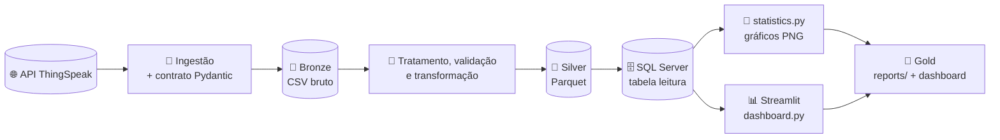
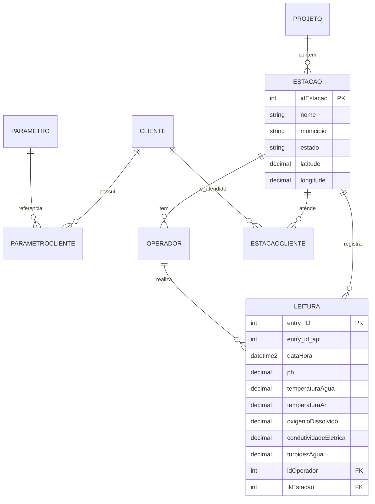

<div align="center">

# Pipeline de Dados para Monitoramento da Qualidade da Água


Ingestão, tratamento e análise estatística de leituras de sensores ambientais.

</div>

Pipeline em **Python** que consome leituras de qualidade da água da API **ThingSpeak**, valida os registros contra um contrato de dados, aplica regras de limpeza, salva a camada Silver em **Parquet** e grava o resultado em um banco **SQL Server**. A partir do banco, o projeto gera gráficos estatísticos em `reports/` e um dashboard interativo em **Streamlit**.

---

## 📑 Sumário

- [O Produto](#-o-produto)
- [Arquitetura](#-arquitetura)
- [Fluxo do pipeline](#-fluxo-do-pipeline)
- [Análise estatística](#-análise-estatística)
- [Dashboard Streamlit](#-dashboard-streamlit)
- [Tecnologias](#️-tecnologias)
- [Banco de dados](#️-banco-de-dados)
- [Dicionário de colunas](#-dicionário-de-colunas)
- [Estrutura de pastas](#-estrutura-de-pastas)
- [Testes](#-testes)
- [Como executar](#-como-executar)

---

## 📦 O Produto

O produto final é composto por:

- 📈 Gráficos estatísticos em PNG (`reports/`)
- 📄 Um diagnóstico em texto (`reports/diagnostico.txt`)
- 🥈 Dados tratados em Parquet (`data/silver/leituras_tratadas.parquet`)
- 🗄️ Dados tratados no SQL Server
- 📊 Um dashboard interativo em Streamlit (`dashboard.py`)

Parâmetros monitorados: **temperatura da água, temperatura do ar, pH, oxigênio dissolvido, condutividade e turbidez**.

---

## 🧭 Arquitetura

Os dados passam por três camadas, cada uma com mais qualidade que a anterior (arquitetura medalhão).



| Camada | Onde fica | O que acontece | Módulos |
|---|---|---|---|
| 🥉 **Bronze** | `data/bronze/leituras_api.csv` | Consome a API, valida o formato, descarta registros sem ID ou repetidos e salva o CSV bruto | `api_client.py`, `data_contract.py`, `service.py` |
| 🥈 **Silver** | `data/silver/leituras_tratadas.parquet` | Renomeia campos, converte tipos, trata `-9999` como nulo, valida datas, ajusta unidades e salva em Parquet | `tratamento.py`, `validacao.py`, `transformacao.py` (executados em sequência por `service.py`) |
| 🗄️ **Banco** | SQL Server, tabela `leitura` | Recebe as leituras tratadas e serve de fonte para a análise e o dashboard | `repository.py`, `db_manager.py` |
| 🥇 **Gold** | `reports/` e Streamlit | Estatísticas, gráficos e dashboard prontos para análise | `statistics.py`, `diagnostico.py`, `dashboard.py` |

---

## 🔄 Fluxo do pipeline

| Etapa | Descrição |
|---|---|
| 1️⃣ **Coleta** | Consulta a API ThingSpeak (canal `2412377`) e recebe as últimas leituras. |
| 2️⃣ **Contrato** | Valida o formato da resposta com Pydantic. |
| 3️⃣ **Bronze** | Remove registros sem ID ou repetidos e salva o CSV bruto. |
| 4️⃣ **Tratamento** | Renomeia campos, converte para número, transforma inválidos em nulos e ajusta data e hora. |
| 5️⃣ **Validação** | Confere se há dados e se as datas são válidas. |
| 6️⃣ **Transformação** | Ajusta os valores de temperatura e pH. |
| 7️⃣ **Silver** | Salva as leituras tratadas em `data/silver/leituras_tratadas.parquet`. |
| 8️⃣ **Persistência** | Grava as leituras tratadas na tabela `leitura`. |
| 9️⃣ **Análise** | Lê o banco, calcula estatísticas e gera gráficos. |
| 🔟 **Entrega** | Salva PNGs e o diagnóstico em `reports/`. O dashboard lê o mesmo banco. |

---

## 📐 Análise estatística

A análise é feita em `src/analytics/statistics.py`, lendo os dados do banco.

| Tipo | O que mostra |
|---|---|
| **Estatísticas descritivas** | Média, mediana, desvio padrão, quartis, mínimo e máximo |
| **Outliers (IQR)** | Valores fora de \[Q1 − 1,5·IQR, Q3 + 1,5·IQR\] |
| **Boxplot** | Um por parâmetro |
| **Histograma** | Um por parâmetro |
| **Comparação** | Água monitorada × águas engarrafadas (parâmetros cadastrados na tabela `cliente`) |
| **Correlação** | Matriz entre todos os parâmetros medidos |

Arquivos gerados em `reports/` ao executar `python main.py`:

| Gráfico | Arquivo |
|---|---|
| Boxplot | `boxplot_<parametro>.png` |
| Histograma | `histograma_<parametro>.png` |
| Comparação com clientes | `comparacao_<parametro>.png` |
| Correlação | `correlacao_parametros.png` |
| Diagnóstico | `diagnostico.txt` |

---

## 📊 Dashboard Streamlit

O arquivo `dashboard.py` lê as leituras direto do SQL Server e mostra gráficos interativos, com filtros por **estação** e **parâmetro** na barra lateral.

| Aba | Conteúdo |
|---|---|
| Tempo | Evolução do parâmetro ao longo do tempo, dispersão (normais × outliers) e mapa das estações |
| Distribuição | Histograma e resumo dos quartis (base do boxplot) |
| Estações | Média, mediana, dispersão e outliers por estação |
| Geral | Outliers por parâmetro e correlação entre parâmetros |
| Tabelas | Estatísticas por estação e leituras com alerta de qualidade |

Para abrir:

```bash
streamlit run dashboard.py
```

O navegador abre em `http://localhost:8501`. Os dados ficam em cache por 10 minutos; para atualizar antes, use **Rerun** ou **Clear cache** no menu do Streamlit.

---

## 🛠️ Tecnologias

| Tecnologia | Aplicação no projeto |
|---|---|
| **Python** | Linguagem principal |
| **Requests** | Consumo da API ThingSpeak |
| **Pydantic** | Contrato de dados da API |
| **Pandas** e **NumPy** | Tratamento e análise |
| **Matplotlib** | Gráficos em PNG |
| **PyArrow** | Gravação da camada Silver em Parquet |
| **SQL Server** + **PyODBC** | Armazenamento e conexão |
| **Streamlit** | Dashboard interativo |
| **Pytest** | Testes automatizados |
| **Git** e **GitHub** | Versionamento |

---

## 🗄️ Banco de dados

O script `src/database/script_db.sql` cria o banco `walter` e as tabelas abaixo.



| Tabela | Função |
|---|---|
| `cliente` | Águas engarrafadas usadas como referência |
| `parametro` | Cadastro dos parâmetros |
| `parametroCliente` | Valor de referência de cada parâmetro por cliente |
| `projeto` | Projeto ao qual as estações pertencem |
| `estacao` | Cadastro das estações (local e coordenadas) |
| `estacaoCliente` | Relação entre estações e clientes |
| `operador` | Técnicos responsáveis (senha armazenada como hash) |
| `leitura` | Medições dos sensores |

---

## 📖 Dicionário de colunas

Os nomes mudam entre as etapas. Esta tabela mostra a correspondência.

| Parâmetro | API | DataFrame tratado | Banco (SQL Server) |
|---|---|---|---|
| Data e hora | `created_at` | `data_hora` | `dataHora` |
| Temperatura da água | `field1` | `temperatura` | `temperaturaAgua` |
| Condutividade | `field3` | `condutividade` | `condutividadeEletrica` |
| Temperatura do ar | `field5` | `temperatura_do_ar` | `temperaturaAr` |
| Turbidez | `field6` | `turbidez` | `turbidezAgua` |
| Oxigênio dissolvido | `field7` | `oxigenio_dissolvido` | `oxigenioDissolvido` |
| pH | `field8` | `ph` | `ph` |

---

## 📁 Estrutura de pastas

```text
pipeline-monitoramento-ambiental/
├── main.py                    # Executa o pipeline completo
├── dashboard.py               # Dashboard Streamlit
├── requirements.txt           # Dependências
├── conftest.py                # Configuração do pytest
├── setup.py                   # Empacotamento do projeto
├── .streamlit/config.toml     # Tema do dashboard
├── data/
│   ├── bronze/                # 🥉 CSV bruto da API (leituras_api.csv)
│   └── silver/                # 🥈 Parquet tratado (leituras_tratadas.parquet)
├── src/
│   ├── config.py              # URL da API e pasta de saída
│   ├── ingestion/             # api_client.py: consumo da API
│   ├── services/              # service.py: orquestra ingestão e tratamento
│   ├── processing/            # Contrato, tratamento, validação, transformação
│   ├── database/              # db_manager, repository, script_db.sql, queries.sql
│   ├── operadors/             # Cadastro de operadores
│   ├── utils/                 # Logs
│   └── analytics/
│       ├── statistics.py      # 🥇 Estatísticas e gráficos
│       └── diagnostico.py     # Diagnóstico em texto
├── tests/                     # Testes automatizados
├── logs/                      # Logs de execução
└── reports/                   # Gráficos e diagnóstico gerados
```

---

## 🧪 Testes

```bash
# Todos os testes
python -m pytest

# Testes individuais
# Testes da comunicação com a API
python -m pytest tests/test_api_client.py

# Testes do contrato de dados
python -m pytest tests/test_data_contract.py

# Testes das análises estatísticas
python -m pytest tests/test_statistics.py

# Testes das transformações
python -m pytest tests/test_transformacao.py

# Testes do tratamento dos dados
python -m pytest tests/test_tratamento.py

# Testes das validações
python -m pytest tests/test_validacao.py

```

Os testes de gráficos usam pastas temporárias e não alteram `reports/`.

---

## 🚀 Como executar

**1. Clone o repositório:**

```bash
git clone https://github.com/Bryan-Anthony/pipeline-monitoramento-ambiental.git
cd pipeline-monitoramento-ambiental
```

**2. Crie e ative o ambiente virtual:**

```bash
python -m venv .venv

# Windows
.venv\Scripts\activate

# Linux/macOS
source .venv/bin/activate
```

**3. Instale as dependências** (inclui Streamlit e PyArrow):

```bash
pip install -r requirements.txt
```

**4. Execute o pipeline** (coleta, tratamento, gravação no banco e gráficos):

```bash
python main.py
```

Para cadastrar operadores antes de rodar o pipeline:

```bash
python main.py --cadastro
```

O terminal pergunta se deseja cadastrar outro operador após cada cadastro. Quando você escolher parar (`0`), o pipeline é executado automaticamente.

**5. Abra o dashboard Streamlit:**

```bash
streamlit run dashboard.py
```

Acesse `http://localhost:8501`. O banco precisa estar acessível e a `.venv` ativa.

---

## 🔮 Possíveis evoluções

- Garantir idempotência: reprocessar uma data sem duplicar linhas
- Alertas quando temperatura ou pH saírem das faixas definidas
- Agendar execuções automáticas do pipeline
- Parametrizar a conexão com o banco por variáveis de ambiente